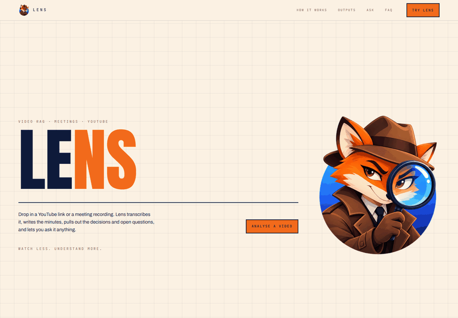
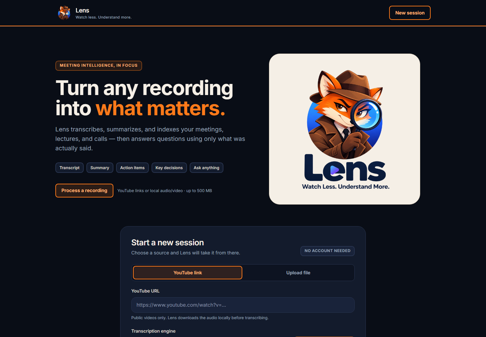
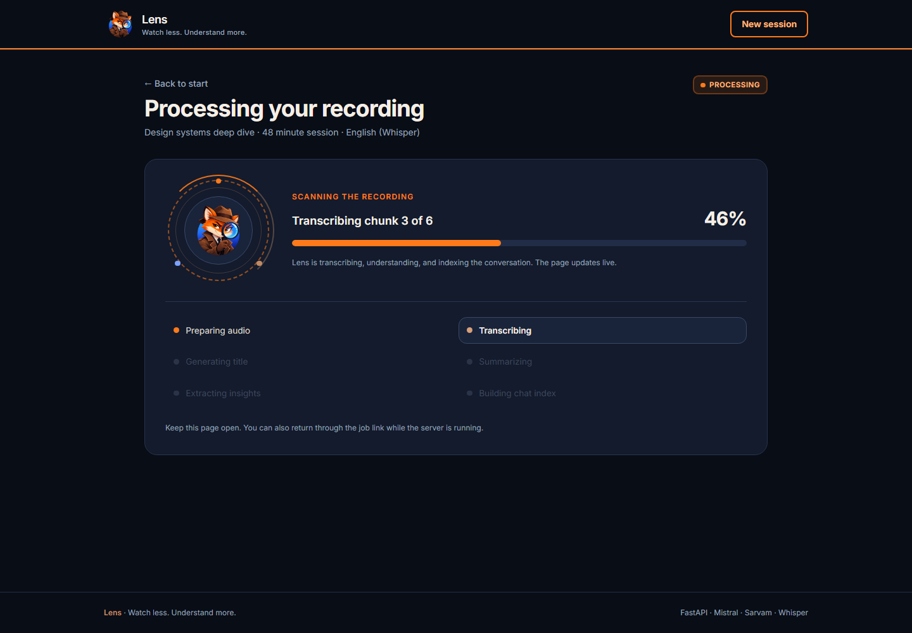
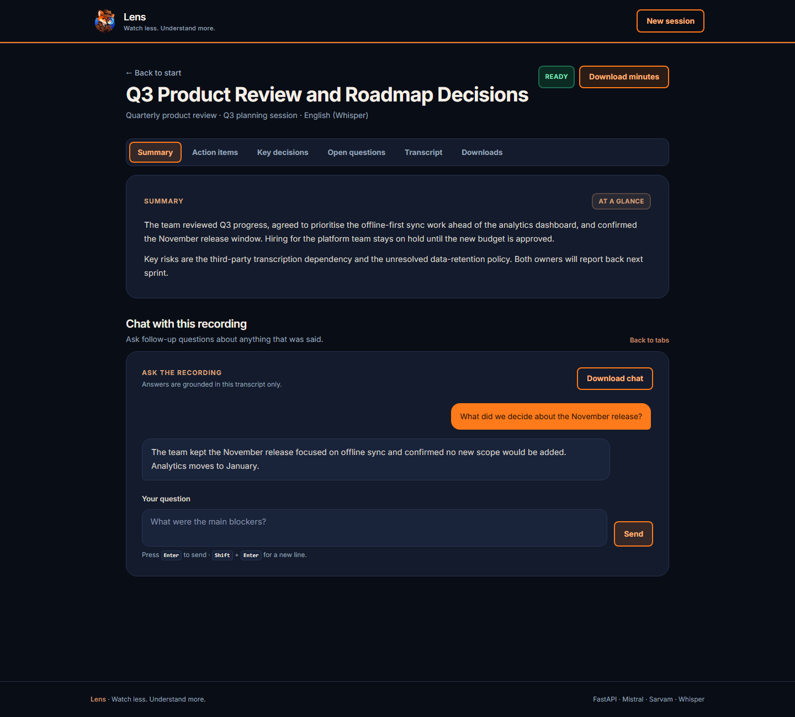
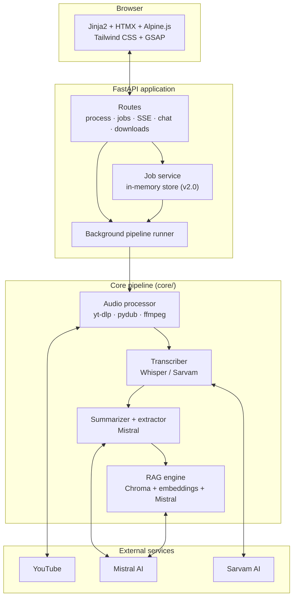
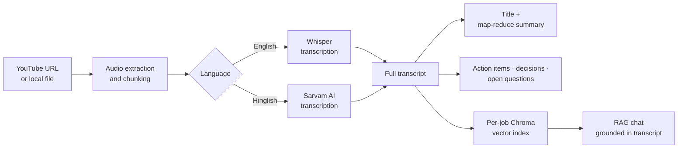

<p align="center">
  
</p>

<h1 align="center">Lens</h1>

<p align="center">
  <strong>Watch less. Understand more.</strong>
</p>

<p align="center">
  Turn any video or meeting recording into a searchable transcript, an AI-generated summary,
  action items, key decisions, open questions — and a chatbot that answers from what was actually said.
</p>

<p align="center">
  <a href="https://www.python.org/"></a>
  <a href="https://fastapi.tiangolo.com/"></a>
  <a href="https://mistral.ai/"></a>
  <a href="https://github.com/openai/whisper"></a>
  <a href="https://www.trychroma.com/"></a>
  <a href="https://github.com/AyushNeedsCaffeine/Lens/blob/main/docs/SRS.md"></a>
</p>

<p align="center">
  
</p>

---

## Table of contents

- [Why Lens](#why-lens)
- [Screenshots](#screenshots)
- [Features](#features)
- [Architecture](#architecture)
- [How it works](#how-it-works)
- [Project structure](#project-structure)
- [Tech stack](#tech-stack)
- [Getting started](#getting-started)
- [Configuration](#configuration)
- [Usage](#usage)
- [HTTP API](#http-api)
- [Design notes](#design-notes)
- [Documentation](#documentation)
- [Future scope](#future-scope)
- [Version roadmap](#version-roadmap)
- [License](#license)
- [Connect](#connect)

## Why Lens

Meetings and long videos contain decisions, owners, deadlines, and unresolved questions — but
finding them means scrubbing through hours of audio. Lens turns the whole recording into a
structured, queryable record in one pass, then lets you ask questions about it later.

It is **local-first**, **single-user**, and works with **English** or **Hinglish / Indic** audio.
Give Lens a YouTube link or a local audio/video file; it handles the rest.

## Screenshots

| Landing | Live processing |
|:---:|:---:|
|  |  |

<p align="center">
  
</p>

## Features

- **Web app** — dark FastAPI + Jinja2 UI with background jobs, live stage progress over SSE,
  animated processing, tabbed results, HTMX chat, and downloadable minutes
- **Flexible input** — YouTube URL or local audio/video file (MP4, MKV, MOV, WebM, AVI, MP3,
  WAV, M4A, AAC, FLAC, OGG; up to 500 MB)
- **Bilingual transcription** — [OpenAI Whisper](https://github.com/openai/whisper) for local
  English transcription, [Sarvam AI](https://www.sarvam.ai/) for Hindi-English (Hinglish) and
  low-memory cloud deployments
- **Handles long recordings** — audio is chunked automatically and summarized map-reduce style,
  so length isn't limited by model context
- **Structured output** — auto-generated title, summary, action items (with owner and deadline),
  key decisions, and open questions
- **Chat with your meeting** — a RAG pipeline (Chroma + local or Mistral embeddings + Mistral)
  answers follow-up questions using only the transcript
- **Export anything** — meeting minutes, summary, transcript, and chat history as downloads
- **Two extra interfaces** — a CLI for automation/debugging and a legacy Streamlit UI

## Architecture

Lens separates the presentation layer, the job orchestration layer, and the reusable core
pipeline. The same `core/` services power the web app, the CLI, and the legacy Streamlit UI.



### Component responsibilities

| Layer | Responsibility |
|---|---|
| `app/main.py` | FastAPI routes, SSR templates, SSE stream, HTMX chat, artifact downloads, soft reset |
| `app/services/jobs.py` | Thread-safe in-memory job store (status, stage, progress, messages) |
| `app/services/pipeline.py` | Background job runner, stage transitions, friendly error mapping, cleanup |
| `core/transcriber.py` | Whisper and Sarvam transcription with cached model loading |
| `core/Summarize.py` | Title generation and map-reduce summarization |
| `core/extractor.py` | Action items, key decisions, and open questions |
| `core/vector_store.py` | Per-recording Chroma collection with local ONNX or Mistral embeddings |
| `core/rag_engine.py` | Top-k retrieval (k=4) and grounded chat chain |
| `utlis/audio_processor.py` | YouTube download, mono 16 kHz conversion, chunking |

## How it works



1. **Ingest** — Lens downloads YouTube audio with `yt-dlp` or accepts an uploaded file, then
   converts it to mono 16 kHz WAV and splits long input into chunks.
2. **Transcribe** — English goes through Whisper (model reused across chunks); Hinglish goes
   through Sarvam AI.
3. **Understand** — Mistral generates a short title, a map-reduce summary, and extracts action
   items with owners/deadlines, key decisions, and open questions.
4. **Index** — The transcript is embedded (local ONNX model or the Mistral API) and stored in an
   isolated Chroma collection for this recording only.
5. **Answer** — Chat retrieves the top matching passages (k=4) and asks Mistral to answer from
   that context, so answers stay grounded in the recording.

## Project structure

```text
Lens/
├── app/                          # FastAPI web UI (v2)
│   ├── main.py                   # Routes, templates, downloads, SSE, HTMX chat
│   ├── config.py                 # Project paths
│   ├── services/
│   │   ├── jobs.py               # In-memory job store
│   │   └── pipeline.py           # Background pipeline runner
│   ├── templates/                # Jinja2 pages and HTMX partials
│   └── static/                   # CSS, JS, and logo marks
├── main.py                       # CLI entry point — pipeline + terminal chat loop
├── app.py                        # Legacy Streamlit UI (v1)
├── assets/                       # Lens branding assets
├── core/
│   ├── transcriber.py            # Whisper + Sarvam AI transcription
│   ├── Summarize.py              # Title generation + map-reduce summarization
│   ├── extractor.py              # Action items / decisions / open questions
│   ├── vector_store.py           # Chroma vector store
│   ├── embeddings.py             # Local ONNX or Mistral embeddings
│   ├── llm.py                    # Mistral SDK chat/embedding client
│   ├── text_splitter.py          # Lightweight transcript chunking
│   └── rag_engine.py             # RAG chain for chatting with the transcript
├── utlis/
│   └── audio_processor.py        # YouTube download, audio conversion, chunking
├── docs/
│   ├── SRS.md                    # Software requirements and future roadmap
│   └── screenshots/              # README preview GIF and screenshots
├── requirements.txt              # Full local install (Whisper/torch)
├── requirements-render.txt       # Lightweight cloud install
├── render.yaml                   # Render Blueprint
├── .env.example
└── .streamlit/config.toml        # Legacy Streamlit theme
```

## Tech stack

| Area | Technology |
|---|---|
| Transcription | OpenAI Whisper, Sarvam AI |
| LLM orchestration | Mistral AI official SDK |
| Vector search | Chroma; local ONNX MiniLM or Mistral `mistral-embed` |
| Audio / video | `yt-dlp`, `pydub`, `ffmpeg` |
| Web UI | FastAPI, Uvicorn, Jinja2, HTMX, Alpine.js, Tailwind CSS, GSAP |
| Legacy UI | Streamlit |
| Language / runtime | Python 3.12 |

## Getting started

### Prerequisites

- **Python 3.12** — the pinned dependencies are verified on 3.12; newer versions may not have
  compatible wheels (for example, `openai-whisper` on 3.14)
- **ffmpeg** installed and on your `PATH` (required by `pydub` and `yt-dlp`)
- A **Mistral AI API key** — used for summarization, extraction, and chat
- A **Sarvam AI API key** — needed for Hinglish transcription and for cloud deployments on
  Render's free plan

### Installation

```bash
git clone https://github.com/AyushNeedsCaffeine/Lens.git
cd Lens
python -m venv venv
source venv/bin/activate        # Windows: venv\Scripts\activate
pip install -r requirements.txt
```

For a CPU-only PyTorch install (recommended if you don't have an NVIDIA GPU), follow the
instructions at the top of [`requirements.txt`](requirements.txt):

```bash
uv pip install --torch-backend=cpu -r requirements.txt
```

With plain `pip`, install the CPU build of Torch first, then the rest:

```bash
pip install torch==2.13.0 --index-url https://download.pytorch.org/whl/cpu
pip install -r requirements.txt
```

For a cloud deployment that uses Sarvam + Mistral and does not need PyTorch/Whisper,
install the lightweight set instead:

```bash
pip install -r requirements-render.txt
```

## Configuration

Copy `.env.example` to `.env` and fill in your keys:

```bash
cp .env.example .env
```

| Variable | Required | Default | Description |
|---|---|---|---|
| `MISTRAL_API_KEY` | Yes | — | Summaries, extraction, embeddings (cloud mode), and RAG chat |
| `MISTRAL_MODEL` | No | `ministral-8b-latest` | Mistral chat model — must be available to your API key's tier |
| `MISTRAL_EMBEDDING_MODEL` | No | `mistral-embed` | Mistral embedding model used when `EMBEDDING_BACKEND=mistral` |
| `SARVAM_API_KEY` | Hinglish / Render | — | Sarvam transcription |
| `SARVAM_STT_MODEL` | No | `saaras:v4` | Sarvam speech-to-text model (`saaras:v4` or legacy `saaras:v2.5`) |
| `WHISPER_MODEL` | No | `small` | Any [Whisper model size](https://github.com/openai/whisper#available-models-and-languages) (`tiny`/`base`/`small`/`medium`/`large`) |
| `TRANSCRIPTION_BACKEND` | No | auto | `whisper` or `sarvam`; defaults to `sarvam` on Render, otherwise `whisper` |
| `EMBEDDING_BACKEND` | No | auto | `local` or `mistral`; defaults to `mistral` on Render, otherwise `local` |

API keys are read only from the environment and are never written to logs or client responses.

### Deploying to Render

The included [`render.yaml`](render.yaml) Blueprint deploys the FastAPI app on Render's free
plan and installs [`requirements-render.txt`](requirements-render.txt), which leaves out
PyTorch, Whisper, and the local embedding stack.

- Set `MISTRAL_API_KEY` and `SARVAM_API_KEY` as secret environment variables in the Render
  dashboard (the Blueprint marks them `sync: false`).
- The Blueprint defaults to `TRANSCRIPTION_BACKEND=sarvam` and
  `EMBEDDING_BACKEND=mistral`, so a 512 MB instance does not need to load Whisper or torch.
- Keep the service at **one worker**. Jobs are stored in memory, and a free instance that spins
  down or restarts clears active and completed jobs.
- If you configure the service manually instead of using the Blueprint, set the same environment
  variables and use `uvicorn app.main:app --host 0.0.0.0 --port $PORT` as the start command.

## Usage

### Web app (v2, recommended)

```bash
python -m uvicorn app.main:app --host 0.0.0.0 --port 8501
```

Open <http://localhost:8501>, choose a YouTube link or upload an audio/video file, pick
**English (Whisper)** or **Hinglish / Indic (Sarvam)**, then start the job.

The job page shows live stage progress over SSE while the pipeline runs in the background, with
an animated lens/fox loader. When it completes you get tabs for **Summary**, **Action items**,
**Key decisions**, **Open questions**, **Transcript**, and **Downloads**, plus a RAG chat panel
below. Chat updates in place via HTMX and falls back to a normal form post if JavaScript is
unavailable. Press **Enter** to send a question or **Shift + Enter** for a new line.

The UI uses a flat, matte dark navy/orange/brown palette with crisp borders and clear
hover/focus states. GSAP motion respects `prefers-reduced-motion`. Clicking the Lens logo asks
for confirmation and returns to the landing page without restarting the server.

> Jobs are held in memory for v2.0, so restarting the server clears them. Durable storage is
> planned for v2.1. The UI loads Tailwind CSS, Alpine.js, HTMX, and GSAP from CDNs.

### CLI

```bash
python main.py
```

You'll be prompted for:

1. A YouTube URL or a path to a local audio/video file
2. A language — `english` or `hinglish`

Once processing finishes, you'll see the title, summary, action items, key decisions, and open
questions — then you can chat with the transcript directly in the terminal (type `exit` to quit).

### Legacy Streamlit UI (v1)

The original Streamlit interface remains available until feature parity is reached:

```bash
streamlit run app.py --server.port 8502
```

Enter a YouTube URL or upload a local file, pick a language, and click **Process video**. Theme
lives in `.streamlit/config.toml`.

### Running from WSL

If the project lives on a Windows drive but you're in a WSL shell, the existing `.venv` is a
Windows virtualenv. Use its interpreter directly (WSL interop):

```bash
./.venv/Scripts/python.exe -m uvicorn app.main:app --host 0.0.0.0 --port 8501   # Web UI
./.venv/Scripts/python.exe main.py                                             # CLI
./.venv/Scripts/python.exe -m streamlit run app.py --server.port 8502          # Legacy UI
```

Alternatively, create a native Linux virtualenv with Python 3.12 and install the requirements
there.

## HTTP API

| Method | Endpoint | Purpose |
|---|---|---|
| `GET` | `/` | Landing page |
| `POST` | `/process` | Start a job from a YouTube URL or uploaded file |
| `GET` | `/jobs/{job_id}` | Job page (processing, error, or results) |
| `GET` | `/jobs/{job_id}/events` | SSE progress stream |
| `GET` | `/api/jobs/{job_id}` | JSON status for polling fallback |
| `POST` | `/jobs/{job_id}/chat` | Ask a question about a completed job (HTMX partial or redirect) |
| `POST` | `/session/reset` | Soft reset — clears the session/job reference without restarting |
| `GET` | `/jobs/{job_id}/download/{artifact}` | Download minutes, summary, transcript, or chat |
| `GET` | `/health` | Health check |

Planned: cancellation (`POST /jobs/{job_id}/cancel`) and a future meeting-bot webhook
(`POST /webhooks/meet`, disabled by default).

## Design notes

- **Server-rendered first** — HTML with progressive enhancement, not a large JavaScript SPA.
- **Provider-agnostic ingestion** — uploads, YouTube, and future meeting bots share the same
  pipeline.
- **One vector collection per recording** — prevents chat context bleeding between unrelated
  videos.
- **Secrets never leave the server** — the browser only receives rendered results.
- **Local by default** — locally, English transcription uses Whisper and the vector index uses
  the local ONNX embedding model; only the text needed for LLM calls is sent to Mistral (and
  audio to Sarvam for Hinglish). Cloud mode sends audio to Sarvam and uses Mistral embeddings.
- **Trust the transcript** — RAG answers are restricted to retrieved transcript context.

## Documentation

- [Software Requirements Specification](docs/SRS.md) — v1 baseline, v2 interface plan, and
  future scope for the Google Meet bot and LangSmith evaluation.

## Future scope

### Near term — v2.1

- Durable job storage (SQLite) so results survive restarts
- Job cancellation
- Automated tests for the pipeline and HTTP API
- Docker image and deployment documentation
- PDF and DOCX exports
- CI/CD pipeline

### v3 — Google Meet bot

Submit a Meet link and have a consented bot join, capture the conversation, and generate the same
transcript, summary, decisions, and minutes automatically. Planned capabilities include:

- Validate Meet URLs, join waiting rooms, and handle admission prompts
- Capture mixed audio and real-time transcript events
- Live transcript and meeting status in the UI
- Speaker diarization and per-participant attribution
- End-of-meeting detection, minutes delivery, and an audit log of consent and bot activity

Integration candidates include the Google Meet Media API (currently a restricted Developer
Preview) and a third-party bot provider such as Recall.ai (recommended). Uploading a recording
remains the fallback.

### Evaluation with LangSmith

- Trace every LLM, extraction, and RAG call per job
- Build offline evaluation datasets from representative meetings
- Measure transcription WER, summary faithfulness/coverage, extraction precision/recall, and RAG
  groundedness/relevance
- Add regression gates before changing prompts, models, or chunking settings
- Redact PII and make tracing opt-in

### Longer term

- Multi-user authentication and per-user data isolation
- Calendar, Slack, Notion, and email integrations
- Live meeting summaries and alerts
- Local/offline LLM and speech-to-text options
- Additional languages and improved Hinglish handling
- Analytics dashboard, usage controls, and configurable retention policies

## Version roadmap

| Version | Highlights |
|---|---|
| **v1.0.x** | Streamlit app and CLI, runtime/config fixes, yt-dlp update, SRS, Lens rebrand |
| **v2.0.0** | FastAPI + Jinja2 + HTMX web UI: background jobs, SSE progress, chat, downloads, logo soft reset |
| **v2.0.1** | Tabbed results and downloads tab, navy/orange/brown refresh, animated loader, Enter-to-send, GSAP motion |
| **v2.0.2** | Flat matte dark theme with solid surfaces, crisp borders, refined hover/focus motion, no gradients/glass/shadows |
| **v2.0.3** | Cloud mode for Render free plan: Sarvam STT + Mistral embeddings, torch-free web process |
| **v2.1** | Durable job storage, cancellation, automated tests, Docker |
| **Future** | Google Meet bot (live capture) and LangSmith-based evaluation/regression testing |

<details>
<summary><strong>Notable fixes</strong></summary>

- [x] Added the missing `langchain-chroma` dependency and pinned all versions against a
      verified-working install
- [x] Fixed `load_rag_chain()` calling `get_retriver()` with no arguments
- [x] Fixed Whisper model loading so long English recordings (>10 minutes, multiple chunks) no
      longer crash on the second chunk
- [x] Isolated the vector store per recording instead of reusing one fixed collection name
- [x] Moved local embeddings to Chroma's ONNX MiniLM model so the web process no longer
      imports torch/sentence-transformers
- [x] Renamed `env.example` → `.env.example` so the documented copy command works
- [x] Made YouTube filename handling robust to any source container
- [x] Made the Mistral model configurable via `MISTRAL_MODEL` to avoid tier-related HTTP 429s
- [x] Fixed `.env` load ordering for `SARVAM_API_KEY`, `WHISPER_MODEL`, and `SARVAM_STT_MODEL`
- [x] Added a lightweight Render mode (Sarvam STT + Mistral embeddings) so the free 512 MB
      instance no longer loads PyTorch/Whisper during processing
- [x] Replaced the LangChain Mistral client with the official `mistralai` SDK to keep
      `transformers`/torch out of the web process
- [x] Updated `yt-dlp` to 2026.10.26 to fix YouTube `HTTP Error 403: Forbidden`
- [x] Added the v2 FastAPI UI, branded logo, soft reset, tabbed results, and reduced-motion GSAP

</details>

## License

No license file is included yet. Until one is added, all rights are reserved by default. Add a
`LICENSE` file (for example MIT or Apache-2.0) if you'd like others to use or contribute to this
project.

## Connect

<div align="center">

[](https://github.com/AyushNeedsCaffeine)
[](https://www.linkedin.com/in/ayush-jain357/)

</div>

<div align="center">

If Lens saves you time, consider starring the repo — it helps others find it too.

</div>
