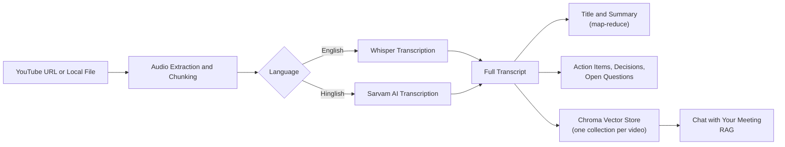
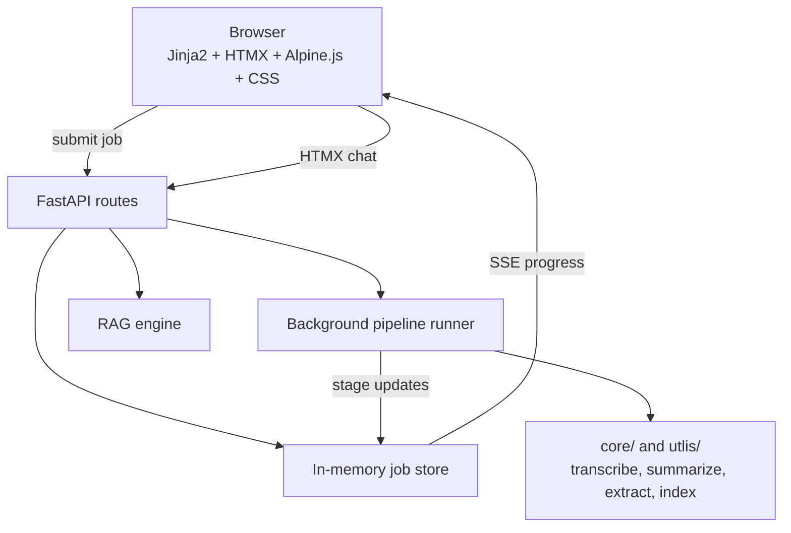

<div align="center">


# Lens

**Watch Less. Understand More.**

Turn any video or meeting recording into a searchable transcript, structured minutes, and a chatbot you can ask questions to.

[](https://lens-3fzs.onrender.com/)


[Live Demo](https://lens-3fzs.onrender.com/) · [Screenshots](#-screenshots) · [How It Works](#-how-it-works) · [Quick Start](#-quick-start) · [Configuration](#%EF%B8%8F-configuration) · [Roadmap](#%EF%B8%8F-roadmap) · [Connect](#-connect)

</div>

---

## 🔍 What is Lens?

Give Lens a **YouTube link** or a **local audio/video file**. It transcribes the audio, then generates a title, summary, action items, key decisions, and open questions. Afterwards you can **chat with the transcript** to ask follow-up questions about anything discussed.

Hour-long meeting? Two-hour lecture? Lens turns it into a few minutes of reading, and anything it didn't cover is one question away.

## 🔗 Live Demo

**👉 https://lens-3fzs.onrender.com/**

Paste a YouTube link (or upload a recording), choose **English (Whisper)** or **Hinglish / Indic (Sarvam)**, and start the job.

> ℹ️ Processing long videos takes time because the audio is downloaded, chunked, and transcribed. The page shows live stage progress while it runs. The first load may also take a few seconds if the server is waking up.

## 📸 Screenshots

<p align="center">
  
</p>

| Landing | Processing | Results |
|:---:|:---:|:---:|
|  |  |  |

## ✨ Features

- 🖥️ **Web app**: light FastAPI + Jinja2 UI with background jobs, live stage progress, animated processing, tabbed results, HTMX chat, and downloadable minutes.
- 🎥 **Flexible input**: YouTube URL or local audio/video file.
- 🌐 **Bilingual transcription**: [OpenAI Whisper](https://github.com/openai/whisper) for English, [Sarvam AI](https://www.sarvam.ai/) for Hindi-English (Hinglish).
- ✂️ **Handles long recordings**: audio is chunked automatically and summarized map-reduce style, so length isn't limited by model context.
- 📝 **Structured output**: auto-generated title, summary, action items (with owner and deadline), key decisions, and open questions.
- 💬 **Chat with your meeting**: a RAG pipeline (Chroma + local ONNX or Mistral embeddings + Mistral) answers follow-up questions about anything discussed.
- 📦 **Downloads**: export the generated minutes and artifacts from the Downloads tab.
- 🛡️ **Daily usage limits**: per-IP and global caps for jobs and chat, reset at 00:00 UTC.
- 🧪 **Two interfaces**: web UI and CLI.
- ♿ **Accessible motion**: CSS transitions respect `prefers-reduced-motion`; chat falls back to a normal form post without JavaScript.

## 🧠 How It Works

### Flow of data



### Pipeline stages

1. **Ingest**: `yt-dlp` downloads YouTube audio, or your uploaded file is used directly; `pydub` + `ffmpeg` convert and split it into chunks.
2. **Transcribe**: each chunk goes to Whisper (English) or Sarvam AI (Hinglish) and the pieces are merged into one transcript.
3. **Summarize**: a map-reduce summarization pass produces the title and summary, regardless of recording length.
4. **Extract**: Mistral pulls out action items (owner and deadline), key decisions, and open questions.
5. **Index**: the transcript is embedded with Chroma's local ONNX MiniLM model, or Mistral embeddings in cloud mode, and stored in an isolated Chroma collection for that video, so context never bleeds between runs.
6. **Chat**: questions are answered by a RAG chain over that collection.

### Web app architecture



## 🚀 Quick Start

### Prerequisites

- **Python 3.12** (pinned dependencies are verified on 3.12; newer versions may lack compatible wheels)
- **[ffmpeg](https://ffmpeg.org/download.html)** installed and on your `PATH` (required by `pydub` and `yt-dlp`)
- A **[Mistral AI](https://console.mistral.ai/)** API key (summaries, extraction, and chat)
- A **[Sarvam AI](https://www.sarvam.ai/)** API key, only if you want Hinglish transcription

### Installation

```bash
git clone https://github.com/AyushNeedsCaffeine/Lens.git
cd Lens
python -m venv venv
source venv/bin/activate        # Windows: venv\Scripts\activate
pip install -r requirements.txt

cp .env.example .env
# edit .env and add your keys
```

### Run the web app

```bash
python -m uvicorn app.main:app --host 0.0.0.0 --port 8501
```

Open <http://localhost:8501>, choose a YouTube link or upload a file, pick a language, and start the job.

When it finishes you get tabs for **Summary**, **Action items**, **Key decisions**, **Open questions**, **Transcript**, and **Downloads**, with the chat panel below. Press **Enter** to send a question or **Shift + Enter** for a new line.

<details>
<summary>Run the CLI</summary>

```bash
python main.py
```

You'll be asked for a YouTube URL or local file path, then a language (`english` or `hinglish`). After processing you'll see the title, summary, action items, decisions, and open questions, then you can chat with the transcript in the terminal (type `exit` to quit).

</details>

<details>
<summary>Running from WSL</summary>

If the project lives on a Windows drive but you're in a WSL shell, the existing `.venv` is a Windows virtualenv. Use its interpreter directly:

```bash
./.venv/Scripts/python.exe -m uvicorn app.main:app --host 0.0.0.0 --port 8501   # Web UI
./.venv/Scripts/python.exe main.py                                             # CLI
```

Or create a native Linux virtualenv with Python 3.12 and install the requirements there.

</details>

## ⚙️ Configuration

Copy `.env.example` to `.env` and fill in your keys.

| Variable | Required | Default | Description |
|---|---|---|---|
| `MISTRAL_API_KEY` | Yes | n/a | Summaries, extraction, and RAG chat |
| `MISTRAL_MODEL` | No | `ministral-8b-latest` | Mistral chat model; must be available to your API key's tier |
| `MISTRAL_EMBEDDING_MODEL` | No | `mistral-embed` | Embedding model used when `EMBEDDING_BACKEND=mistral` |
| `SARVAM_API_KEY` | Only for Hinglish / cloud STT | n/a | Sarvam transcription |
| `WHISPER_MODEL` | No | `small` | Any [Whisper model size](https://github.com/openai/whisper#available-models-and-languages) (`tiny` / `base` / `small` / `medium` / `large`) |
| `SARVAM_STT_MODEL` | No | `saaras:v4` | Sarvam speech-to-text model |
| `TRANSCRIPTION_BACKEND` | No | Auto: `whisper` locally, `sarvam` on Render | `whisper` or `sarvam` |
| `EMBEDDING_BACKEND` | No | Auto: `local` locally, `mistral` on Render | `local` or `mistral` |
| `RATE_LIMIT_ENABLED` | No | `true` | Enable daily usage limits |
| `DAILY_JOB_LIMIT_PER_IP` | No | `3` | Jobs per client IP per UTC day; `0` disables |
| `DAILY_JOB_LIMIT_GLOBAL` | No | `25` | Total jobs per UTC day; `0` disables |
| `DAILY_CHAT_LIMIT_PER_IP` | No | `40` | Chat messages per client IP per UTC day; `0` disables |
| `DAILY_CHAT_LIMIT_GLOBAL` | No | `400` | Total chat messages per UTC day; `0` disables |
| `TRUST_PROXY_HEADERS` | No | Auto: `true` on Render | Trust `X-Forwarded-For` / `X-Real-IP` from a hosting proxy |

## 🛠️ Tech Stack

| Layer | Tools |
|---|---|
| Transcription | [OpenAI Whisper](https://github.com/openai/whisper), [Sarvam AI](https://www.sarvam.ai/) |
| LLM orchestration | [LangChain](https://www.langchain.com/), [Mistral AI](https://mistral.ai/) |
| Vector search | [Chroma](https://www.trychroma.com/), local ONNX MiniLM embeddings, or [Mistral](https://mistral.ai/) embeddings in cloud mode |
| Audio / video | `yt-dlp`, `pydub`, `ffmpeg` |
| Web UI | [FastAPI](https://fastapi.tiangolo.com/) + [Uvicorn](https://www.uvicorn.org/), Jinja2, [HTMX](https://htmx.org/), [Alpine.js](https://alpinejs.dev/), CSS design system |

## 📁 Project Structure

```
Lens/
├── app/                      # FastAPI web UI
│   ├── main.py               # Routes, templates, downloads, SSE, HTMX chat
│   ├── config.py             # Project paths
│   ├── services/
│   │   ├── jobs.py           # In-memory job store
│   │   ├── pipeline.py       # Background pipeline runner
│   │   └── rate_limit.py     # Daily per-IP/global usage limits
│   ├── templates/            # Jinja2 pages and HTMX partials
│   └── static/               # CSS, JS, and logo marks
├── main.py                   # CLI entry point: pipeline, then a chat loop
├── assets/                   # Lens branding assets
├── core/
│   ├── transcriber.py        # Whisper + Sarvam AI transcription
│   ├── Summarize.py          # Title generation + map-reduce summarization
│   ├── extractor.py          # Action items / decisions / open questions
│   ├── vector_store.py       # Chroma vector store
│   ├── embeddings.py         # Local ONNX or Mistral embeddings
│   ├── llm.py                # Mistral chat/embedding client
│   ├── text_splitter.py      # Transcript chunking
│   └── rag_engine.py         # RAG chain for chatting with the transcript
├── utlis/
│   └── audio_processor.py    # YouTube download, audio conversion, chunking
├── docs/
│   ├── SRS.md                # Requirements and future roadmap
│   └── screenshots/          # README preview and screenshots
├── requirements.txt          # Full local install (Whisper/PyTorch)
├── requirements-render.txt   # Lightweight cloud/Render install
└── render.yaml               # Render deployment config
```

## ⚠️ Known Limitations

- Jobs are held **in memory** in v2.0, so restarting the server clears them.
- Daily rate-limit counters are also held in memory and reset when the process restarts.
- Alpine.js and HTMX load from CDNs; the CSS and app JavaScript are served locally.
- Output quality depends on the transcription and the Mistral model tier you use.
- Hinglish transcription requires a Sarvam AI key.
- YouTube downloads depend on `yt-dlp`; keep it updated if downloads start failing.

## 🗺️ Roadmap

| Version | Highlights |
|---|---|
| **v1.0.x** | Initial web UI and CLI, runtime/config fixes, `yt-dlp` update, SRS, Lens rebrand |
| **v2.0.0** | FastAPI + Jinja2 + HTMX web UI: background jobs, SSE progress, chat, downloads, logo soft reset |
| **v2.0.1** | Tabbed results and downloads tab, navy/orange/brown refresh, animated loader, Enter-to-send, page motion |
| **v2.0.2** | Flat matte dark theme with solid surfaces, crisp borders, refined hover/focus motion |
| **v2.1** *(planned)* | Durable job storage (SQLite), cancellation, automated tests, Docker |
| **Future** | Google Meet bot (live capture) and LangSmith-based evaluation / regression testing |

## 📚 Documentation

- [Software Requirements Specification](docs/SRS.md): v1 baseline, v2 interface plan, and future scope for the Google Meet bot and LangSmith evaluation.

## 📄 License

No license file is included yet. Add a `LICENSE` file (e.g. MIT or Apache-2.0) if you'd like others to use or contribute to this project.

---

<div align="center">

## 🤝 Connect

**Built by Ayush**: B.Tech IT student at MAIT, GGSIPU, Delhi, building with LLMs, agents, and RAG.

[](https://github.com/AyushNeedsCaffeine)
[](https://www.linkedin.com/in/ayush-jain357/)

⭐ **If Lens saved you an hour of watching, drop a star. It keeps me motivated to keep building!**

*Watch Less. Understand More.*

</div>